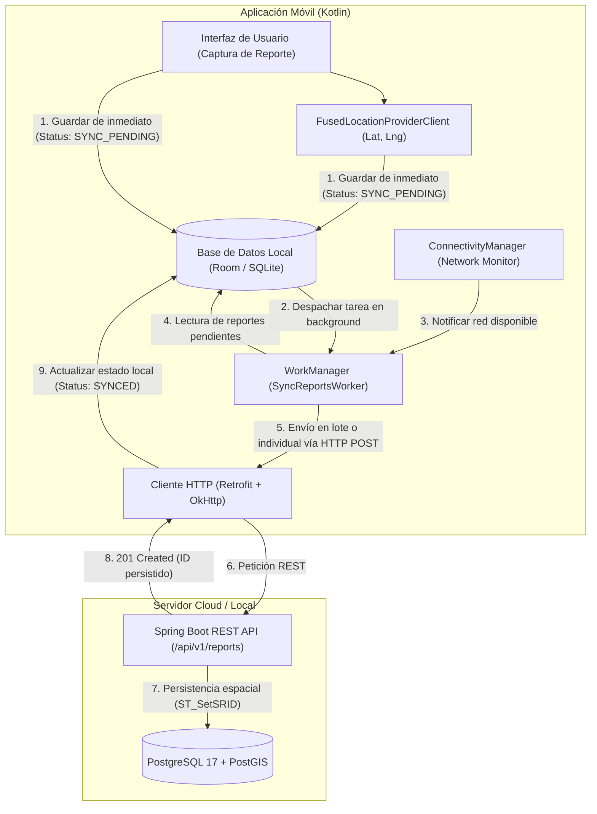

# AlertCity - Documento de Contexto General del Proyecto

## 1. Visión y Propósito del Proyecto

**AlertCity** es una plataforma tecnológica orientada a la participación ciudadana y la optimización de los servicios públicos municipales. Su objetivo principal es permitir a los habitantes de una localidad reportar incidencias urbanas y problemáticas de interés social en tiempo real (tales como baches, fallas en el alumbrado público, fugas de agua potable, drenajes colapsados, alcantarillas abiertas, acumulación de basura y situaciones de riesgo), estableciendo un canal de comunicación directo y transparente con las dependencias gubernamentales encargadas de atenderlas.

A través de la aplicación móvil, los ciudadanos capturan la problemática georreferenciada de forma precisa, mientras que los operadores y autoridades municipales disponen de información estructurada para priorizar cuadrillas de trabajo, dar seguimiento al ciclo de vida del reporte y notificar su resolución.

---

## 2. Arquitectura Offline-First

Uno de los pilares fundamentales de AlertCity es su **arquitectura Offline-First**. En entornos urbanos y rurales es habitual enfrentarse a "zonas muertas" de conectividad celular (sótanos, carreteras, colonias en la periferia o fallas temporales de red móvil). 

AlertCity garantiza que la experiencia del usuario no se interrumpa ante la falta de conexión:



### Principios de Operación Offline-First:
1. **Persistencia Local Inmediata**: Al crear un reporte, la información se persiste al instante en la base de datos interna SQLite mediante la librería **Room**, asignándole un estado local de sincronización (`SYNC_PENDING`).
2. **Geolocalización en Sitio**: La ubicación exacta se obtiene en el momento del reporte utilizando el hardware GPS del dispositivo (`FusedLocationProviderClient`), evitando que la ubicación se pierda o distorsione si el reporte se sube horas más tarde.
3. **Sincronización en Segundo Plano con WorkManager**: Se encola una tarea de sincronización administrada por el sistema operativo Android con restricciones estrictas de red (`NetworkType.CONNECTED`). Android garantiza que, incluso si la aplicación se cierra o el dispositivo se reinicia, la tarea se ejecutará en cuanto haya conexión a internet estable.
4. **Idempotencia y Resolución de Conflictos**: Los identificadores de reportes utilizan UUIDs generados desde el origen, asegurando que reintentos de red no generen registros duplicados en el servidor.

---

## 3. Stack Tecnológico

El proyecto está construido sobre tecnologías modernas, estándares de la industria y arquitecturas desacopladas:

| Capa / Componente | Tecnología | Rol en la Solución |
| :--- | :--- | :--- |
| **Cliente Móvil** | **Kotlin 2.x** | Lenguaje de desarrollo nativo para Android. |
| | **Android Jetpack Room** | Capa de abstracción sobre SQLite para persistencia offline. |
| | **Android Jetpack WorkManager** | Programación y ejecución de tareas diferidas de sincronización. |
| | **Google Play Services Location** | Captura precisa de coordenadas de latitud y longitud. |
| | **Retrofit 2 + OkHttp 3** | Cliente HTTP tipado para consumo de la API REST del backend. |
| | **Kotlin Coroutines & Flow** | Concurrencia estructurada y manejo reactivo del estado en la UI. |
| **Backend REST API** | **Java 21 (LTS)** | Plataforma de ejecución del lado del servidor. |
| | **Spring Boot 3.x / 4.x** | Framework empresarial para la creación de microservicios y APIs REST. |
| | **Spring Data JPA & Hibernate** | Mapeo objeto-relacional (ORM) y gestión de transacciones. |
| | **Hibernate Spatial + JTS** | Soporte de tipos geométricos y geoespaciales (`org.locationtech.jts.geom.Point`). |
| | **Spring Security** | Mecanismos de autenticación, autorización y control de acceso. |
| | **Flyway Migration** | Control de versiones y evolución automatizada del esquema de BD. |
| | **SpringDoc OpenAPI (Swagger)** | Documentación interactiva de los endpoints REST expuestos. |
| **Base de Datos & GIS** | **PostgreSQL 17** | Motor relacional robusto, transaccional y escalable. |
| | **Extensión PostGIS 3.5** | Almacenamiento, indexación espacial (GiST) y consultas geográficas avanzadas. |
| | **Extensión pgcrypto** | Generación de identificadores únicos universales (`gen_random_uuid()`). |
| **Contenerización & DevOps** | **Docker** | Empaquetamiento desacoplado de la aplicación en contenedores Linux. |
| | **Docker Compose** | Orquestación de servicios en desarrollo y producción (`backend`, `db`, `pgadmin`). |
| | **Nginx** | Reverse Proxy para terminación SSL (HTTPS) y redirección de tráfico al backend. |
| | **Microsoft Azure** | Proveedor cloud para despliegue en Máquina Virtual Linux (Ubuntu Server). |

---

## 4. Matriz de Comunicación e Interfaces

El flujo de información entre subsistemas opera de forma desacoplada mediante protocolos estándares:

```
[ Android App (Kotlin) ]
       │
       │ HTTP / HTTPS (JSON via Retrofit)
       ▼
[ Nginx Reverse Proxy (Puerto 80 / 443) ]
       │
       │ Reverse Proxy Pass (localhost:8080)
       ▼
[ Spring Boot API (Puerto 8080) ]
       │
       │ TCP/IP JDBC (jdbc:postgresql://db:5432/alertcity_db)
       ▼
[ PostgreSQL 17 + PostGIS (Puerto 5432) ]
```

### Protocolos y Contratos de Integración:
1. **Cliente Móvil $\leftrightarrow$ Backend**:
   - **Protocolo**: REST sobre HTTP (entorno local de desarrollo/demo) y HTTPS (producción en Azure).
   - **Formato**: Cargas útiles en JSON (`application/json`) con cabeceras `Accept` y `Content-Type`.
   - **Coordenadas**: El cliente envía pares numéricos `{ "latitude": 20.1458, "longitude": -101.1923 }`. El backend los procesa y traduce internamente a geometrías PostGIS `ST_SetSRID(ST_MakePoint(longitude, latitude), 4326)`.
   - **Evidencia Multimedia (Fotos)**:
     - *Etapa Demo*: Campo de texto con URL simulada o mock.
     - *Etapa Producción*: Petición `multipart/form-data` hacia el backend, el cual transfiere el archivo binario hacia un contenedor de Azure Blob Storage y almacena el enlace público en la BD.
2. **Backend $\leftrightarrow$ Base de Datos (PostgreSQL/PostGIS)**:
   - Conexión JDBC a través de un pool HikariCP.
   - Las consultas geoespaciales aprovechan funciones nativas de PostGIS como `ST_DWithin` (búsqueda por radio), `ST_Distance` (cálculo métrico) y `ST_AsGeoJSON`.
3. **Entorno Docker Interno**:
   - Enlace a través de la red bridge de Docker (`alertcity_default`).
   - El backend se conecta al host `db:5432` utilizando el DNS interno de Docker.

---

## 5. Modelo de Dominio y Entidades Principales

El diseño del modelo de datos está normalizado para optimizar el almacenamiento y permitir extensiones futuras:

### A. Usuario (`users`)
Representa a cualquier actor que interactúa con la plataforma (ciudadano o funcionario municipal).
- `id_user` (UUID): Identificador único universal.
- `username` (VARCHAR 100, UNIQUE): Nombre de usuario único para inicio de sesión.
- `email` (VARCHAR 150, UNIQUE): Correo electrónico del usuario.
- `password` (VARCHAR 255): Hash de la contraseña.
- `rol` (VARCHAR 50): Rol o área asignada (`VIALIDAD`, `ALUMBRADO`, `AGUA_DRENAJE`, `LIMPIEZA`, `SEGURIDAD`, `AREAS_VERDES`, `ANIMALES`).
- `first_name` / `last_name` (VARCHAR 100): Nombre y apellidos.
- `created_at` (TIMESTAMP): Fecha y hora de creación de la cuenta.

### B. Reporte (`reports`)
Representa una problemática reportada en la vía pública.
- `id_report` (UUID): Identificador único universal del reporte.
- `id_user` (UUID, FK): Referencia al usuario ciudadano que originó el reporte.
- `title` (VARCHAR 150): Resumen corto de la problemática.
- `description` (TEXT): Explicación detallada de la situación y afectaciones.
- `category` (VARCHAR 50): Categoría (`VIALIDAD`, `ALUMBRADO`, `AGUA`, `LIMPIEZA`, `SEGURIDAD`, `AREAS_VERDES`, `ANIMALES`, `OTRO`).
- `urgent` (BOOLEAN): Bandera de criticidad o peligro inminente.
- `date_time` (TIMESTAMP): Momento exacto en que ocurrió o se registró el incidente.
- `location` (GEOMETRY(Point, 4326)): Coordenadas geográficas exactas (Longitud, Latitud) bajo el estándar espacial WGS 84.
- `address_reference` (VARCHAR 255): Referencia textual urbana (calle, número, cruces, colonia).
- `state` (VARCHAR 50): Estado de atención (`ENVIADO`, `EN_PROCESO`, `RESUELTO`).
- `created_at` / `updated_at` (TIMESTAMP): Marcas de auditoría temporal.
