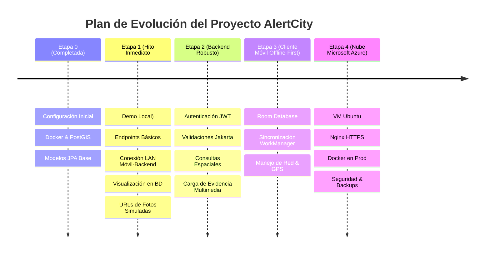

# AlertCity - Matriz de Roadmap, Tareas y Estado del Proyecto

Este documento desglosa el trabajo realizado, en progreso y planificado para **AlertCity** en sus tres componentes centrales: **Backend**, **Base de Datos** e **Infraestructura / Despliegue**.

---

## Convención de Estados
- `[X] Completado`: Tarea finalizada, probada y validada.
- `[/] En Progreso`: Tarea en proceso activo de desarrollo o ajuste.
- `[ ] Pendiente`: Tarea planificada pero aún no iniciada.

---

## Resumen Ejecutivo de Etapas

---

## Etapa 0: Fundaciones y Configuración Base (Completada)

| ID | Área | Tarea / Entregable | Estado | Notas Técnicas |
| :--- | :--- | :--- | :---: | :--- |
| **0.1** | Backend | Inicialización de proyecto Maven con Spring Boot 3/4 y Java 21 | `[X]` | Configurado con `pom.xml`, dependencias Web, Data JPA, Security, Actuator, Flyway. |
| **0.2** | Base de Datos | Configuración de PostgreSQL 17 con extensión PostGIS 3.5 | `[X]` | Dockerizado usando la imagen oficial `postgis/postgis:17-3.5-alpine`. |
| **0.3** | Base de Datos | Script de inicialización y migración base (`V1__init.sql`) | `[X]` | Creación de tablas `users` y `reports`, índices GiST y extensiones `pgcrypto` y `postgis`. |
| **0.4** | Backend | Definición de Entidades JPA con soporte espacial | `[X]` | Clases `User` y `Report` sincronizadas con tipos `Point` de JTS (`hibernate-spatial`). |
| **0.5** | Infraestructura | Dockerfile multi-stage y Docker Compose para desarrollo local | `[X]` | Servicios `backend`, `db` con healthcheck, y `pgadmin` bajo perfil `tools`. |

---

## Etapa 1: Hito Inmediato - Demo Local en Red LAN (Objetivo Actual)

> **Alcance de la Demo:**
> - Permitir el registro de reportes desde la aplicación móvil en Kotlin.
> - Mostrar y listar los reportes persistidos en la base de datos PostgreSQL/PostGIS.
> - Conexión del dispositivo móvil físico o emulador a través de la red Wi-Fi local hacia la IP del equipo anfitrión (`http://192.168.1.6:8080`).
> - **Evidencias fotográficas:** Para esta etapa de la demo, las fotos **no** se suben como binarios; se manejan mediante URLs simuladas / placeholder.
> - **Autenticación en la demo:** Simplificada (los reportes se asocian a un usuario semilla predeterminado de la base de datos).

| ID | Área | Tarea / Entregable | Estado | Detalle y Criterios de Aceptación |
| :--- | :--- | :--- | :---: | :--- |
| **1.1** | Base de Datos | Migración con Dataset enriquecido (`V2__seed_test_data.sql`) | `[X]` | Inserción de catálogo de usuarios de prueba y más de 20 reportes realistas con coordenadas PostGIS en la zona. |
| **1.2** | Backend | DTOs de Entrada y Salida para la Demo (`ReportRequestDTO`, `ReportResponseDTO`) | `[ ]` | Creación de Records en Java 21 para transferir latitud/longitud decimales y serializar a/desde el cliente Kotlin. |
| **1.3** | Backend | Servicio y Controlador de Reportes (`ReportController`, `ReportService`) | `[ ]` | Endpoints `POST /api/v1/reports` (crear reporte) y `GET /api/v1/reports` (listar reportes existentes). |
| **1.4** | Backend | Conversor Geoespacial (Lat/Lng $\leftrightarrow$ JTS Point PostGIS) | `[ ]` | Utilidad para construir `Point(longitud, latitud)` con SRID 4326 a partir de los datos recibidos de la app móvil. |
| **1.5** | Backend | Configuración de CORS y acceso abierto para endpoints de Demo | `[ ]` | Permitir peticiones desde cualquier origen local sin bloqueos de Spring Security durante la demo. |
| **1.6** | Infraestructura | Verificación de Firewall de Windows y conectividad LAN | `[ ]` | Asegurar que el puerto 8080 permita tráfico entrante desde la IP `192.168.1.6` para dispositivos en la misma red Wi-Fi. |
| **1.7** | Cliente Móvil | Integración Retrofit básica en Kotlin para Demo | `[ ]` | Configuración del `baseUrl = "http://192.168.1.6:8080/api/v1/"` y llamada al endpoint de creación y listado. |
| **1.8** | Validación | Prueba de extremo a extremo: Registro en App $\to$ Verificación en pgAdmin | `[ ]` | Crear un reporte en el celular y verificar la inserción inmediata del punto geográfico en pgAdmin. |

---

## Etapa 2: Estructuración Avanzada del Backend (Post-Demo)

| ID | Área | Tarea / Entregable | Estado | Detalle y Criterios de Aceptación |
| :--- | :--- | :--- | :---: | :--- |
| **2.1** | Backend | Módulo de Seguridad y Autenticación JWT | `[ ]` | Registro de ciudadanos, login, generación y validación de tokens JWT (`AccessToken` de 1h y `RefreshToken` de 30 días). |
| **2.2** | Backend | Roles y Control de Acceso Basado en Roles (RBAC) | `[ ]` | Permisos específicos para ciudadanos (`ROLE_CITIZEN`) y operadores de dependencias (`ROLE_OPERATOR`, `ROLE_ADMIN`). |
| **2.3** | Backend | Consultas Geoespaciales Avanzadas con PostGIS | `[ ]` | Endpoint `GET /api/v1/reports/nearby?lat=...&lng=...&radiusKm=...` usando `ST_DWithin` sobre el índice GiST. |
| **2.4** | Backend | Filtros de Reportes por Categoría, Estado y Rango de Fechas | `[ ]` | Soporte para paginación (`Pageable`) y especificaciones de búsqueda dinámica. |
| **2.5** | Backend | Módulo de Manejo de Evidencias Fotográficas Reales | `[ ]` | Endpoint `POST /api/v1/reports/{id}/media` con `MultipartFile`, validación de tipo de imagen (JPEG/PNG) y tamaño máximo. |
| **2.6** | Backend | Manejo Global de Errores (`@ControllerAdvice`) | `[ ]` | Respuestas de error estandarizadas (`ProblemDetails` / RFC 7807) para errores 400, 401, 403, 404 y 500. |
| **2.7** | Backend | Documentación con Swagger UI / OpenAPI 3 | `[ ]` | Anotaciones `@Operation`, esquemas de DTOs documentados accesibles en `/swagger-ui.html`. |

---

## Etapa 3: Arquitectura Offline-First en el Cliente Móvil (Kotlin)

| ID | Área | Tarea / Entregable | Estado | Detalle y Criterios de Aceptación |
| :--- | :--- | :--- | :---: | :--- |
| **3.1** | Cliente Móvil | Base de Datos Local con Room (`ReportEntity`, `ReportDao`) | `[ ]` | Estructura de tablas locales con estados `SYNC_PENDING`, `SYNCED`, `SYNC_ERROR`. |
| **3.2** | Cliente Móvil | Repositorio con Estrategia *Single Source of Truth* | `[ ]` | La UI siempre observa los datos de Room; el repositorio decide cuándo sincronizar con la API remota. |
| **3.3** | Cliente Móvil | Tarea de Sincronización en Segundo Plano con WorkManager | `[ ]` | `SyncReportsWorker` periódico y bajo demanda con restricción `NetworkType.CONNECTED` y reintento exponencial. |
| **3.4** | Cliente Móvil | Captura de Coordenadas con `FusedLocationProviderClient` | `[ ]` | Solicitud y validación de permisos de ubicación (`ACCESS_FINE_LOCATION`) al capturar el reporte. |
| **3.5** | Cliente Móvil | Captura y Compresión de Fotos | `[ ]` | Uso de CameraX o selector de imágenes, compresión a WebP/JPEG antes del almacenamiento local y subida. |
| **3.6** | Cliente Móvil | Interceptor de Autenticación y Token Refresh en OkHttp | `[ ]` | Inyección automática del header `Authorization: Bearer <token>` y renovación silenciosa ante códigos 401. |

---

## Etapa 4: Despliegue en la Nube de Microsoft Azure

| ID | Área | Tarea / Entregable | Estado | Detalle y Criterios de Aceptación |
| :--- | :--- | :--- | :---: | :--- |
| **4.1** | Infraestructura | Aprovisionamiento de Máquina Virtual en Azure (Linux Ubuntu) | `[ ]` | VM tipo Standard_B2s (2 vCPU, 4GB RAM) con Ubuntu 24.04 LTS y disco SSD administrado. |
| **4.2** | Infraestructura | Configuración del Network Security Group (NSG) de Azure | `[ ]` | Apertura estricta de puertos: 22 (SSH con clave pública), 80 (HTTP) y 443 (HTTPS). Puerto 5432 cerrado a internet. |
| **4.3** | Infraestructura | Configuración de Nginx Reverse Proxy | `[ ]` | Redirección de peticiones entrantes en el puerto 80/443 hacia el contenedor del backend en `localhost:8080`. |
| **4.4** | Infraestructura | Certificado SSL / TLS con Let's Encrypt (Certbot) | `[ ]` | Habilitación de HTTPS para que el cliente Android no requiera excepciones de tráfico inseguro (Cleartext). |
| **4.5** | Infraestructura | Docker Compose de Producción (`docker-compose.prod.yml`) | `[ ]` | Configuración de políticas de reinicio (`restart: always`), volúmenes persistentes y variables de entorno protegidas. |
| **4.6** | Infraestructura | Contenedor de Almacenamiento Azure Blob Storage (Opcional Prod) | `[ ]` | Integración del SDK oficial de Azure Storage para desacoplar el almacenamiento de fotos del disco de la VM. |

---

## Etapa 5: Pruebas, Verificación y Entrega Final

| ID | Área | Tarea / Entregable | Estado | Detalle y Criterios de Aceptación |
| :--- | :--- | :--- | :---: | :--- |
| **5.1** | Calidad | Pruebas Unitarias de Servicios (`JUnit 5` + `Mockito`) | `[ ]` | Pruebas de lógica de negocio, validaciones de estados y transiciones de reportes. |
| **5.2** | Calidad | Pruebas de Integración con Testcontainers | `[ ]` | Ejecución de suite de tests levantando un contenedor PostgreSQL+PostGIS efímero con Flyway. |
| **5.3** | Calidad | Prueba de Resiliencia Offline en Móvil | `[ ]` | Simular pérdida de red (modo avión), crear 3 reportes, activar red y verificar sincronización automática exitosa. |
| **5.4** | Calidad | Auditoría de Seguridad de Endpoints y Carga de Archivos | `[ ]` | Verificación de inyecciones SQL, validación de extensiones de archivos y límites de tamaño. |
| **5.5** | Documentación | Manual de Despliegue y Guía de Operación | `[ ]` | Instrucciones paso a paso para encender, apagar, actualizar y respaldar la base de datos en Azure. |
