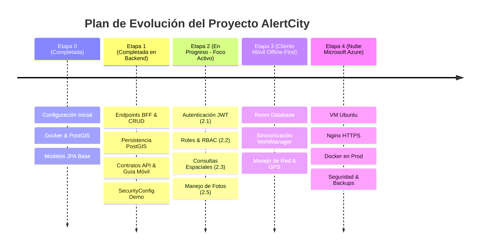
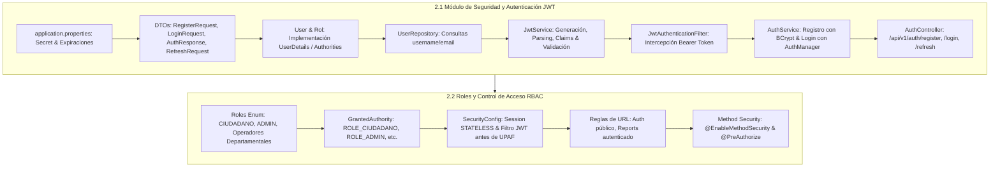

# AlertCity - Matriz de Roadmap, Tareas y Estado del Proyecto

Este documento desglosa el trabajo realizado, en progreso y planificado para **AlertCity** en sus tres componentes centrales: **Backend**, **Base de Datos** e **Infraestructura / Despliegue**.

---

## Convención de Estados
- `[X] Completado`: Tarea finalizada, probada, documentada y validada en código.
- `[/] En Progreso`: Tarea en proceso activo de diseño, estructuración o desarrollo.
- `[ ] Pendiente`: Tarea planificada en el backlog pero aún no iniciada.

---

## Resumen Ejecutivo de Etapas

---

## Índice de Documentación Técnica Generada

| Documento | Ubicación | Descripción |
| :--- | :--- | :--- |
| **Visión General y Reglas** | [`AlertCity-Project.md`](file:///c:/Users/garci/Documentos/ITSUR/7%20Semestre/Programacion%20Movil/AlertCity-Backend/Documentation/AlertCity-Project.md) | Arquitectura general, modelo de dominio, convenciones y estrategia Offline-First. |
| **Contratos de API y JSON** | [`API_CONTRACTS.md`](file:///c:/Users/garci/Documentos/ITSUR/7%20Semestre/Programacion%20Movil/AlertCity-Backend/Documentation/API_CONTRACTS.md) | Especificación formal de endpoints, esquemas JSON, enumerados y código Kotlin/Retrofit listo para producción. |
| **Guía de Pruebas Locales (LAN)** | [`LOCAL_TESTING_GUIDE.md`](file:///c:/Users/garci/Documentos/ITSUR/7%20Semestre/Programacion%20Movil/AlertCity-Backend/Documentation/LOCAL_TESTING_GUIDE.md) | Configuración de firewall, IP anfitrión (`192.168.1.6`), `cleartextTraffic` en Android y flujo de verificación. |
| **Arquitectura del Sistema** | [`SYSTEM_ARCHITECTURE.md`](file:///c:/Users/garci/Documentos/ITSUR/7%20Semestre/Programacion%20Movil/AlertCity-Backend/Documentation/SYSTEM_ARCHITECTURE.md) | Documento maestro de arquitectura: capas Spring Boot, PostgreSQL/PostGIS, Nginx, Docker y despliegue en VM Azure. |
| **Roadmap y Seguimiento** | [`ROADMAP_AND_TRACKING.md`](file:///c:/Users/garci/Documentos/ITSUR/7%20Semestre/Programacion%20Movil/AlertCity-Backend/Documentation/ROADMAP_AND_TRACKING.md) | Matriz viva de seguimiento de hitos, estados de tareas y especificación técnica de sprints. |

---

## Etapa 0: Fundaciones y Configuración Base (Completada)

| ID | Área | Tarea / Entregable | Estado | Notas Técnicas |
| :--- | :--- | :--- | :---: | :--- |
| **0.1** | Backend | Inicialización de proyecto Maven con Spring Boot 3/4 y Java 21 | `[X]` | Configurado con `pom.xml`, dependencias Web, Data JPA, Security, Actuator, Flyway. |
| **0.2** | Base de Datos | Configuración de PostgreSQL 17 con extensión PostGIS 3.5 | `[X]` | Dockerizado usando la imagen oficial `postgis/postgis:17-3.5-alpine`. |
| **0.3** | Base de Datos | Script de inicialización y migración base (`V1__init.sql`) | `[X]` | Creación de tablas `users` y `reports`, índices GiST y extensiones `pgcrypto` y `postgis`. |
| **0.4** | Backend | Definición de Entidades JPA con soporte espacial | `[X]` | Clases `User` y `Report` sincronizadas con tipos `Point` de JTS (`hibernate-spatial`). |
| **0.5** | Infraestructura | Dockerfile multi-stage y Docker Compose para desarrollo local | `[X]` | Servicios `backend`, `db` con healthcheck, y `pgadmin` bajo perfil `tools`. |

---

## Etapa 1: Hito Demo Local en Red LAN (Completada en Backend)

> **Resultado del Hito:**
> - Backend completamente operativo y verificado en entorno local/LAN.
> - BFF `DashboardController` (`GET /api/v1/dashboard`) entregando métricas (`myActiveReportsCount`, `mySolvedReportsCount`), reportes propios y feed comunitario en una sola petición HTTP.
> - CRUD de creación de reportes `ReportController` (`POST /api/v1/reports`) persistiendo geometrías `Point` SRID 4326 en PostgreSQL/PostGIS.
> - Seguridad configurada temporalmente con `permitAll()` en `/api/v1/**` y `csrf().disable()` para desbloquear pruebas locales de la app móvil.
> - Contratos de API, modelos de datos de Kotlin y guía de configuración LAN entregados formalmente al equipo móvil.

| ID | Área | Tarea / Entregable | Estado | Detalle y Criterios de Aceptación |
| :--- | :--- | :--- | :---: | :--- |
| **1.1** | Base de Datos | Migración con Dataset enriquecido (`V2__seed_test_data.sql`) | `[X]` | Inserción de catálogo de usuarios de prueba y más de 20 reportes realistas con coordenadas PostGIS en la zona. |
| **1.2** | Backend | DTOs de Entrada y Salida para la Demo | `[X]` | Records `CreateReportRequest`, `ReportResponse` y `DashboardResponse` creados y compilando. |
| **1.3** | Backend | Servicios de Lógica de Negocio (`ReportService`, `DashboardService`) | `[X]` | Métodos de creación, mapeo geoespacial, cálculo de métricas de reportes activos y resueltos. |
| **1.4** | Backend | Controladores REST (`ReportController`, `DashboardController`) | `[X]` | Endpoints `POST /api/v1/reports`, `GET /api/v1/reports` y `GET /api/v1/dashboard` estructurados. |
| **1.5** | Backend | Conversor Geoespacial (Lat/Lng $\leftrightarrow$ JTS Point PostGIS) | `[X]` | Utilidad para construir `Point(longitud, latitud)` con SRID 4326 a partir de los datos recibidos de la app móvil. |
| **1.6** | Backend | Configuración de Seguridad Abierta para Demo (`SecurityConfig`) | `[X]` | Implementado en `com.AlertCity_Backend.security.SecurityConfig`: `csrf(AbstractHttpConfigurer::disable)` y `.requestMatchers("/api/v1/**").permitAll()`. |
| **1.7** | Infraestructura | Verificación de Firewall de Windows y conectividad LAN | `[X]` | Documentado con comandos PowerShell en `LOCAL_TESTING_GUIDE.md` para apertura del puerto 8080 en la IP anfitrión. |
| **1.8** | Cliente Móvil | Integración Retrofit básica en Kotlin para Demo | `[X]` | Código completo de modelos Kotlin y servicio Retrofit entregado en `API_CONTRACTS.md` y `LOCAL_TESTING_GUIDE.md`. |
| **1.9** | Validación | Prueba de extremo a extremo: Registro en App $\to$ Verificación en pgAdmin | `[/]` | Backend 100% probado y compilando sin errores; pendiente de validación visual final por el equipo móvil en dispositivo físico. |

---

## Etapa 2: Estructuración Avanzada del Backend (En Progreso - Foco Activo)

### Desglose y Plan de Ejecución para 2.1 y 2.2

La etapa 2 transforma el backend desde el modo demo permisivo hacia un sistema con seguridad de grado de producción sin romper la compatibilidad con el cliente móvil.

| ID | Área | Tarea / Entregable | Estado | Detalle y Criterios de Aceptación |
| :--- | :--- | :--- | :---: | :--- |
| **2.1** | Backend | **Módulo de Seguridad y Autenticación JWT** | `[/]` | **En estructuración activa**. Implementación de autenticación sin estado mediante tokens JWT con JJWT 0.12.6. |
| 2.1.1 | Configuración | Parámetros JWT en `application.properties` | `[ ]` | Definición de `jwt.secret` (clave HMAC-SHA de al menos 256 bits), `jwt.access-token-expiration` (1 hora = 3600000 ms) y `jwt.refresh-token-expiration` (30 días = 2592000000 ms). |
| 2.1.2 | DTOs | DTOs de Autenticación | `[ ]` | Records: `RegisterRequest` (username, email, password, firstName, lastName), `LoginRequest` (user/email, password), `AuthResponse` (accessToken, refreshToken, tokenType, user info), `RefreshTokenRequest` (refreshToken). |
| 2.1.3 | Dominio | Implementación `UserDetails` en Entidad `User` | `[ ]` | Adaptar `User.java` (o clase `CustomUserDetails`) para implementar `UserDetails`, mapeando `rol` a `GrantedAuthority` con prefijo `ROLE_` y banderas booleanas de cuenta activa. |
| 2.1.4 | Persistencia | Métodos de Búsqueda en `UserRepository` | `[ ]` | Métodos `findByUser(String username)`, `findByEmail(String email)`, `existsByUser(String username)` y `existsByEmail(String email)`. |
| 2.1.5 | Seguridad | Servicio Criptográfico `JwtService` | `[ ]` | Generación de tokens firmados HMAC-SHA256 (`Keys.hmacShaKeyFor`), extracción de claims (sujeto, roles, expiración), validación de firma y fecha de caducidad. |
| 2.1.6 | Seguridad | Filtro HTTP `JwtAuthenticationFilter` | `[ ]` | Extiende `OncePerRequestFilter`: extrae `Bearer <token>` del header `Authorization`, valida token vía `JwtService`, carga `UserDetails` y setea el contexto en `SecurityContextHolder`. |
| 2.1.7 | Negocio | Servicio de Autenticación `AuthService` | `[ ]` | Registro de nuevos usuarios con cifrado `BCryptPasswordEncoder`, login usando `AuthenticationManager`, y flujo de renovación con refresh token. |
| 2.1.8 | Controladores | Controlador REST `AuthController` | `[ ]` | Endpoints `POST /api/v1/auth/register`, `POST /api/v1/auth/login` y `POST /api/v1/auth/refresh` con respuestas HTTP 200/201 y 400/401 documentadas. |
| **2.2** | Backend | **Roles y Control de Acceso Basado en Roles (RBAC)** | `[/]` | **En estructuración activa**. Segregación estricta de permisos entre ciudadanos y operadores/administradores municipales. |
| 2.2.1 | Dominio | Catálogo de Roles Jerárquico en `Rol.java` | `[X]` | Enum `Rol` configurado con `CIUDADANO`, `ADMIN` y áreas operativas (`VIALIDAD`, `ALUMBRADO`, `AGUA_DRENAJE`, `LIMPIEZA`, `SEGURIDAD`, `AREAS_VERDES`, `ANIMALES`). |
| 2.2.2 | Seguridad | Actualización de `SecurityConfig` (Stateless + Filtros) | `[ ]` | Configuración de `SessionCreationPolicy.STATELESS`, registro de `JwtAuthenticationFilter` antes de `UsernamePasswordAuthenticationFilter`, y `AuthenticationProvider` con DAO. |
| 2.2.3 | Seguridad | Habilitación de Seguridad a Nivel de Método | `[ ]` | Anotación `@EnableMethodSecurity(prePostEnabled = true)` en configuración de seguridad. |
| 2.2.4 | Seguridad | Autorización de Endpoints por Roles | `[ ]` | Reglas en filterChain: `/api/v1/auth/**` público; `/api/v1/reports/**` y `/api/v1/dashboard` requieren `isAuthenticated()`; endpoints de cambio de estado o reasignación requieren `hasRole('ADMIN')` o roles operativos correspondientes. |
| **2.3** | Backend | Consultas Geoespaciales Avanzadas con PostGIS | `[ ]` | Endpoint `GET /api/v1/reports/nearby?lat=...&lng=...&radiusKm=...` usando `ST_DWithin` sobre el índice GiST. |
| **2.4** | Backend | Filtros de Reportes por Categoría, Estado y Rango de Fechas | `[ ]` | Soporte para paginación (`Pageable`) y especificaciones de búsqueda dinámica (`JpaSpecificationExecutor`). |
| **2.5** | Backend | Módulo de Manejo de Evidencias Fotográficas Reales | `[ ]` | Endpoint `POST /api/v1/reports/{id}/media` con `MultipartFile`, validación de tipo de imagen (JPEG/PNG) y tamaño máximo. |
| **2.6** | Backend | Manejo Global de Errores (`@ControllerAdvice`) | `[ ]` | Respuestas de error estandarizadas (`ProblemDetails` / RFC 7807) para errores 400, 401, 403, 404 y 500. |
| **2.7** | Backend | Documentación con Swagger UI / OpenAPI 3 | `[ ]` | Anotaciones `@Operation`, esquemas de DTOs documentados accesibles en `/swagger-ui.html` con soporte para autorización Bearer. |

---

## Etapa 3: Arquitectura Offline-First en el Cliente Móvil (Kotlin)

| ID | Área | Tarea / Entregable | Estado | Detalle y Criterios de Aceptación |
| :--- | :--- | :--- | :---: | :--- |
| **3.1** | Cliente Móvil | Base de Datos Local con Room (`ReportEntity`, `ReportDao`) | `[ ]` | Estructura de tablas locales con estados `SYNC_PENDING`, `SYNCED`, `SYNC_ERROR`. |
| **3.2** | Cliente Móvil | Repositorio con Estrategia *Single Source of Truth* | `[ ]` | La UI siempre observa los datos de Room; el repositorio decide cuándo sincronizar con la API remota. |
| **3.3** | Cliente Móvil | Tarea de Sincronización en Segundo Plano con WorkManager | `[ ]` | `SyncReportsWorker` periódico y bajo demanda con restricción `NetworkType.CONNECTED` y reintento exponencial. |
| **3.4** | Cliente Móvil | Captura de Coordenadas con `FusedLocationProviderClient` | `[ ]` | Solicitud y validación de permisos de ubicación (`ACCESS_FINE_LOCATION`) al capturar el reporte. |
| **3.5** | Cliente Móvil | Captura y Compresión de Fotos | `[ ]` | Uso de CameraX o selector de imágenes, compresión a WebP/JPEG antes del almacenamiento local y subida. |
| **3.6** | Cliente Móvil | Interceptor de Autenticación y Token Refresh en OkHttp | `[ ]` | Inyección automática del header `Authorization: Bearer <token>` y renovación silenciosa ante códigos 401. |

---

## Etapa 4: Despliegue en la Nube de Microsoft Azure

| ID | Área | Tarea / Entregable | Estado | Detalle y Criterios de Aceptación |
| :--- | :--- | :--- | :---: | :--- |
| **4.1** | Infraestructura | Aprovisionamiento de Máquina Virtual en Azure (Linux Ubuntu) | `[ ]` | VM tipo Standard_B2s (2 vCPU, 4GB RAM) con Ubuntu 24.04 LTS y disco SSD administrado. |
| **4.2** | Infraestructura | Configuración del Network Security Group (NSG) de Azure | `[ ]` | Apertura estricta de puertos: 22 (SSH con clave pública), 80 (HTTP) y 443 (HTTPS). Puerto 5432 cerrado a internet. |
| **4.3** | Infraestructura | Configuración de Nginx Reverse Proxy | `[ ]` | Redirección de peticiones entrantes en el puerto 80/443 hacia el contenedor del backend en `localhost:8080`. |
| **4.4** | Infraestructura | Certificado SSL / TLS con Let's Encrypt (Certbot) | `[ ]` | Habilitación de HTTPS para que el cliente Android no requiera excepciones de tráfico inseguro (Cleartext). |
| **4.5** | Infraestructura | Docker Compose de Producción (`docker-compose.prod.yml`) | `[ ]` | Configuración de políticas de reinicio (`restart: always`), volúmenes persistentes y variables de entorno protegidas. |
| **4.6** | Infraestructura | Contenedor de Almacenamiento Azure Blob Storage (Opcional Prod) | `[ ]` | Integración del SDK oficial de Azure Storage para desacoplar el almacenamiento de fotos del disco de la VM. |

---

## Etapa 5: Pruebas, Verificación y Entrega Final

| ID | Área | Tarea / Entregable | Estado | Detalle y Criterios de Aceptación |
| :--- | :--- | :--- | :---: | :--- |
| **5.1** | Calidad | Pruebas Unitarias de Servicios (`JUnit 5` + `Mockito`) | `[ ]` | Pruebas de lógica de negocio, validaciones de estados y transiciones de reportes. |
| **5.2** | Calidad | Pruebas de Integración con Testcontainers | `[ ]` | Ejecución de suite de tests levantando un contenedor PostgreSQL+PostGIS efímero con Flyway. |
| **5.3** | Calidad | Prueba de Resiliencia Offline en Móvil | `[ ]` | Simular pérdida de red (modo avión), crear 3 reportes, activar red y verificar sincronización automática exitosa. |
| **5.4** | Calidad | Auditoría de Seguridad de Endpoints y Carga de Archivos | `[ ]` | Verificación de inyecciones SQL, validación de extensiones de archivos y límites de tamaño. |
| **5.5** | Documentación | Manual de Despliegue y Guía de Operación | `[ ]` | Instrucciones paso a paso para encender, apagar, actualizar y respaldar la base de datos en Azure. |

---

## Historial de Revisiones

| Fecha | Versión | Autor | Cambios Principales |
| :--- | :---: | :--- | :--- |
| **02/11/2026** | 1.0 | Antigravity AI / Equipo Backend | Creación inicial del roadmap con desglose de Etapas 0 a 5. |
| **02/11/2026** | 1.1 | Antigravity AI / Equipo Backend | Actualización tras implementación de DTOs, servicios y controladores de Demo. |
| **03/11/2026** | 1.2 | Antigravity AI / Equipo Backend | Cierre de Etapa 1 en Backend (`SecurityConfig` completado, contratos API y guía LAN). Desglose exhaustivo de tareas 2.1 y 2.2 para autenticación JWT y RBAC. |
